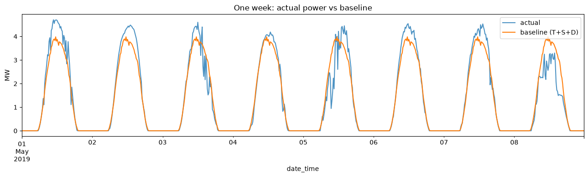
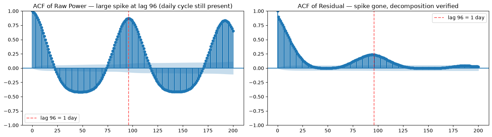
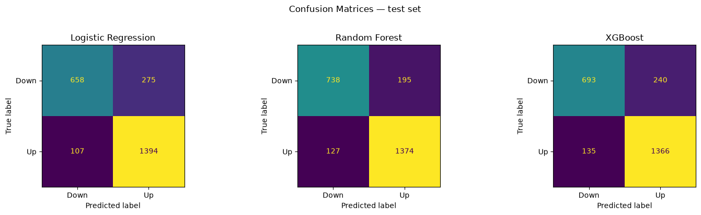
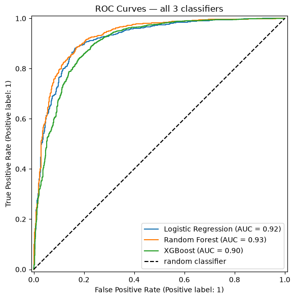
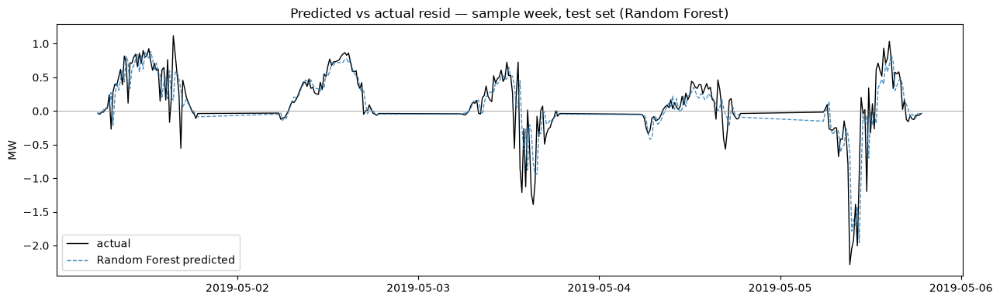
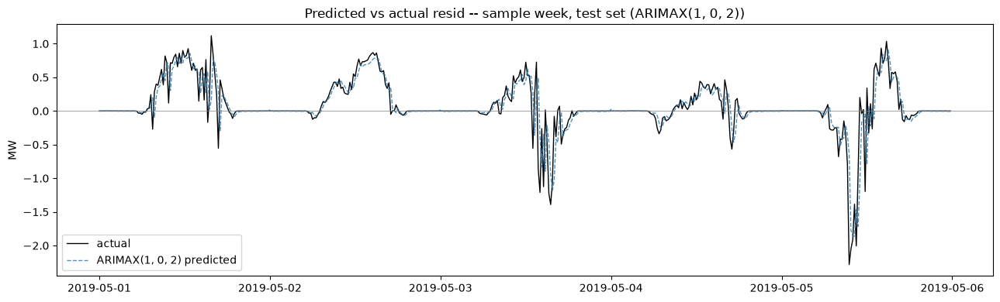
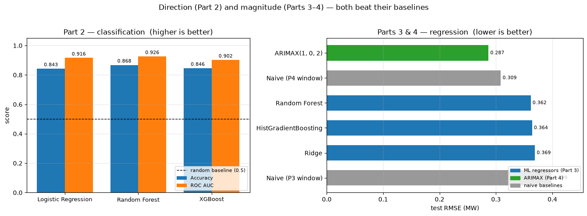
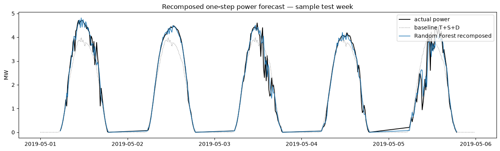

# Short-Term PV Power Forecasting — Decomposition, Machine Learning & ARIMAX


Next-step (15-minute-ahead) forecasting of a utility-scale photovoltaic plant's power output, built as **Project 6 — Small-scale PV System Forecasting** for the *Energy Data Engineering 2 (EDE2)* course.

The core idea: split the power signal into a **predictable part** (trend + monthly season + daily solar profile) and a **weather-driven residual**, then attack that residual with three different families of models — classification, ML regression and classical ARIMAX — and compare them fairly.

**Author:** Atharva Kulkarni

---

## Dataset

| | |
|---|---|
| **Source** | PVOD v1.0 — *A photovoltaic power output dataset* ([doi:10.11922/sciencedb.01094](https://doi.org/10.11922/sciencedb.01094)) |
| **Station** | `station00` — 6,600 kW poly-Si ground-mounted plant, Hebei province, China (38.05° N, 114.95° E) |
| **Period** | 2018-08-15 → 2019-06-13 at 15-minute resolution (28,992 timestamps) |
| **Target** | `power` (MW) |
| **Inputs** | 7 NWP forecast variables (`nwp_*`, known in advance) and 6 local measurements (`lmd_*`, used only as lags) |

The data file is **not included** in this repository. Download `station00.csv` from the PVOD dataset page and place it next to the notebook.

---

## Approach

```
power(t) = T(t) + S(t) + D(t) + residual(t)
           └────── baseline ──────┘   └── forecast this ──┘
```

| Stage | What it does |
|---|---|
| **Stage 0 — Cleaning** | Removes one duplicate timestamp, rebuilds a gap-free 15-min grid (97 missing slots, incl. one full day) and fills gaps with the same clock-time from the adjacent day. Converts UTC → local time (UTC+8). |
| **Part 1 — EDA & decomposition** | Month × time-of-day climatology split into a linear **T**rend, monthly **S**easonal level and season-varying **D**aily profile. Stationarity verified with ADF and ACF/PACF (daily lag-96 spike disappears from the residual). |
| **Part 2 — Classification** | Predicts whether the next residual goes **Up or Down** (±0.05 MW dead-band removes night-time noise). Logistic Regression, Random Forest (GridSearch-tuned) and XGBoost, all with `TimeSeriesSplit` CV. |
| **Part 3 — Regression** | Predicts the **exact value** of the next residual on daylight rows. Ridge, Random Forest and HistGradientBoosting, tuned with GridSearchCV, compared to naive persistence. Includes error analysis by hour of day. |
| **Part 4 — ARIMAX** | ARIMAX(p, 0, q) with standardised NWP forecasts as exogenous regressors. Order chosen by AIC (→ **ARIMAX(1,0,2)**), true one-step-ahead test predictions with frozen parameters, full residual diagnostics. |
| **Part 5 — Synthesis** | Recomposes forecasts back to the power scale, builds a skill-vs-naive scoreboard and re-evaluates every model on an **identical** daylight evaluation set for a fair comparison. |

All splits are strictly chronological (80 % train / 20 % test) — no shuffling, no look-ahead.

---

## Key results

| Part | Best approach | Metric | Score |
|---|---|---|---|
| 1 — Decomposition | T + S + D climatology | Variance of power explained (R²) | **83.1 %** |
| 2 — Classification | Random Forest (tuned) | Test accuracy / ROC-AUC | **86.8 % / 0.926** |
| 3 — Regression | Random Forest | Test RMSE on residual (daylight rows) | **0.362 MW** (naive: 0.399) |
| 4 — ARIMAX | ARIMAX(1,0,2) | Test RMSE on residual (full series) | **0.287 MW** (naive: 0.309) |

**Fair comparison** (same 2,713 daylight test rows for every model):

| Model | RMSE (MW) | MAE (MW) | Skill vs naive |
|---|---|---|---|
| **Random Forest** | **0.362** | **0.207** | **+9.3 %** |
| HistGradientBoosting | 0.364 | 0.209 | +8.7 % |
| Ridge | 0.369 | 0.216 | +7.4 % |
| ARIMAX(1,0,2) | 0.371 | 0.210 | +6.9 % |
| Naive persistence | 0.399 | 0.216 | — |

**Takeaways**

- The deterministic baseline already explains most of the signal; every forecaster is fighting over the remaining weather-driven residual, so gains over persistence are real but modest (7–9 %).
- Recent history dominates: `lag_0` / `lag_1` (Parts 2–3) and the AR term (Part 4) carry most of the predictive power; NWP forecasts are useful but secondary.
- Predicting **Up** is easier than **Down** (recall ≈ 0.92 vs ≈ 0.79) — cloud onset is more abrupt than clearing.
- Errors are unbiased but largest around **sunrise and sunset**, where cloud cover changes fastest.
- ARIMAX's lower headline RMSE comes partly from easy night-time zeros; on identical daylight rows the tree-based Random Forest is the strongest point forecaster, while ARIMAX remains the most interpretable (explicit coefficients, confidence intervals, diagnostics).

---

## Selected figures

| Actual vs baseline (T+S+D) | ACF before / after decomposition |
|---|---|
|  |  |

| Confusion matrices (Part 2) | ROC curves (Part 2) |
|---|---|
|  |  |

| Random Forest — predicted vs actual residual | ARIMAX(1,0,2) — predicted vs actual residual |
|---|---|
|  |  |

**Model comparison**



**Forecast recomposed on the power scale**



---

## Repository structure

```
.
├── PV_Power_Forecasting_station00.ipynb   # full analysis notebook (with outputs)
├── figures/                               # key plots exported from the notebook
├── requirements.txt
└── README.md
```

---

## How to run

```bash
git clone https://github.com/AtharvaSV/PV-Power-Forecasting-ML-ARIMAX.git
cd PV-Power-Forecasting-ML-ARIMAX

python3.11 -m venv .venv
source .venv/bin/activate          # Windows: .venv\Scripts\activate
pip install -r requirements.txt

# put station00.csv (from PVOD) in this folder, then:
jupyter notebook PV_Power_Forecasting_station00.ipynb
```

Run all cells top to bottom. The Random Forest grid searches and the ARIMAX AIC search take a few minutes on a laptop.

---

## Limitations & future scope

- Single station, ~10 months of data — no full annual cycle and no cross-station validation.
- NWP inputs are treated as error-free; forecast uncertainty is not propagated.
- Next steps: seasonal SARIMAX (daily/weekly period), multi-step-ahead forecasting for dispatch and curtailment planning, and validation across multiple PVOD stations.

---

## References

- Yao, T. et al. (2021). *A photovoltaic power output dataset: Multi-source photovoltaic power output dataset with Python toolkit.* Solar Energy, 230, 122–130. [doi:10.1016/j.solener.2021.09.050](https://doi.org/10.1016/j.solener.2021.09.050)
- PVOD v1.0 dataset — [doi:10.11922/sciencedb.01094](https://doi.org/10.11922/sciencedb.01094)
- [statsmodels SARIMAX](https://www.statsmodels.org/stable/generated/statsmodels.tsa.statespace.sarimax.SARIMAX.html) · [scikit-learn ensemble methods](https://scikit-learn.org/stable/modules/ensemble.html)
